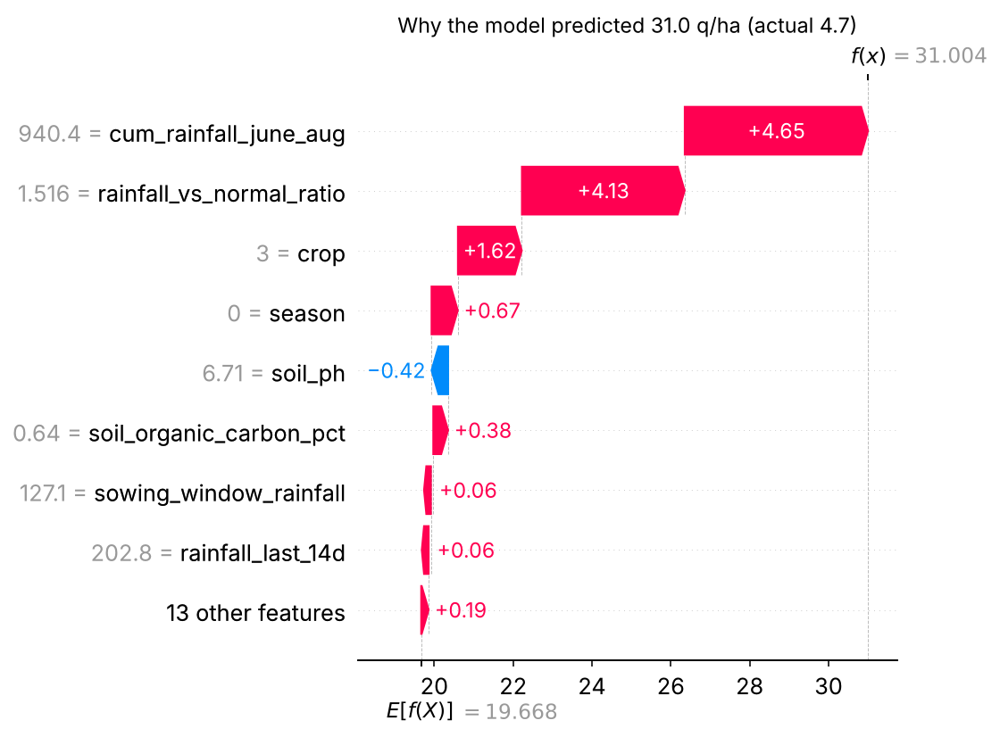

# Case Study: One Large Error in the Test Period (2022-2024)

> Data in this project is **synthetic**. The record below is a real row of the generated test set; all numbers are computed by `src/case_study.py`.

**Record:** `REC_0340473` | YTL_DARWHA_003, Yavatmal | rice | season 2023

## 1. Predicted vs actual
| | q/ha |
|---|---:|
| Actual yield (cleaned) | **4.70** |
| Model forecast (as of 31 Aug) | **31.00** |
| Error | **+26.30** (+560% of actual) -> over-predicted |
| Historical normal for this district-crop (anchor) | 24.27 |
| Naive last-year baseline | 25.47 |
| Average abs. error on the whole test set | 1.50 |

This is the single worst of 54,433 test predictions, i.e. 17.5x the typical error.

## 2. What the model saw (SHAP waterfall)

Largest contributions (q/ha, relative to the model's average of 19.67):
- `cum_rainfall_june_aug` = 940.40 (scaled/encoded value): **+4.65 q/ha**
- `rainfall_vs_normal_ratio` = 1.52 (scaled/encoded value): **+4.13 q/ha**
- `crop` = 3.00 (scaled/encoded value): **+1.62 q/ha**
- `season` = 0.00 (scaled/encoded value): **+0.67 q/ha**
- `soil_ph` = 6.71 (scaled/encoded value): **-0.42 q/ha**

Reading: the model starts from the district-crop normal of 24.3 q/ha and adjusts using rainfall, soil and crop features. For this record the inputs looked ordinary (rainfall at or above normal: 940 mm, ratio 1.52; longest dry spell 1 weeks; organic carbon 0.64%), so the model predicted a normal yield.

## 3. Was it a data problem, an unusual event, or a model limitation?
- **Data problem (cleaning error).** The raw yield was 470.0. The cleaning rule read it as kg/ha and divided by 100, giving 4.7 q/ha. The ground-truth log shows this row had NO kg/ha unit error: 400-950 values were injected as extreme outliers, and this one overlaps the range where kg/ha and an outlier look alike. The 'corrected' label is therefore wrong, and the model's forecast of 31.0 q/ha (close to the district-crop normal of 24.3) was actually sensible. Across the test set 68 rows (0.12%) were wrongly unit-fixed; test MAE is 1.505 on all rows and 1.496 when they are excluded.
- Part of the June-August rainfall was missing and imputed, so the weather features for this record are estimates.

Raw input check: raw yield in file = 470.0, unit-fix = kg_to_quintal, missing rainfall weeks = 1. Share of all test records that were unit-fixed: 5.13%.

## 4. What we would change
1. **Fix the cleaning rule**: do not auto-convert values that are ambiguous between 'kg/ha' and 'outlier'; flag them for review (and exclude from training/evaluation) instead.
2. Re-run the unit-fix accuracy check against the ground-truth log after every cleaning change.
3. Report forecasts as intervals and aggregate to district-crop level for procurement, where single bad labels average out.

## 2-minute talk track
"Our worst test miss: the model said 31.0 q/ha for a rice field in Yavatmal, the record said 4.7. When I traced it, the model was fine: the raw yield was 470.0, an extreme outlier that my unit-fix rule wrongly divided by 100. It is a cleaning error, 68 test rows are affected, and the fix is to flag values that fit both a kg/ha and an outlier reading instead of auto-converting them."
